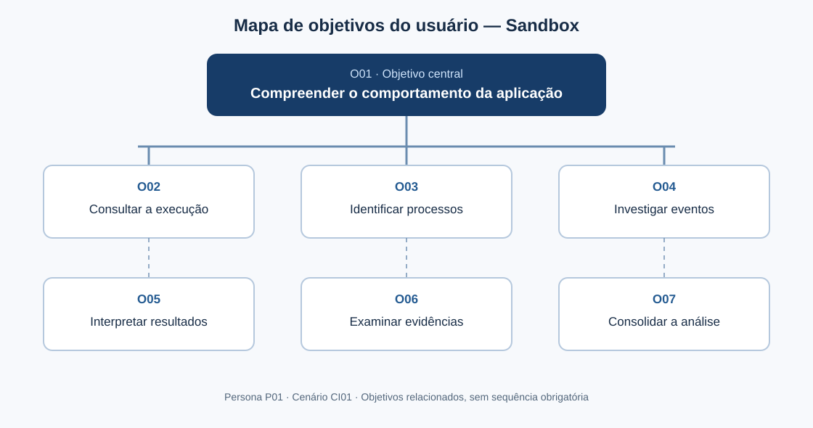

# Entrega 9 — Modelo conceitual e design centrado na comunicação

**Data:** 14/10/2026  
**Status:** 🟩 Concluído  
**Responsabilidade:** solução individual de Luiggi Paschoalini Garcia, com consolidação individual do mapa de objetivos e do esquema de signos (equipe de um integrante).  
**Projeto:** Implementação e análise de um ambiente sandbox para execução controlada de aplicações potencialmente não confiáveis em sistemas operacionais.

## Objetivo da atividade

Transformar o cenário de problema C01 em uma concepção de interação, identificando os objetivos do usuário, os tópicos e subtópicos de conversa, as falas entre usuário e preposto do designer e os signos necessários para compreender o comportamento de aplicações analisadas em ambiente controlado.

O modelo descreve **o que precisa ser comunicado**, e não a implementação de componentes gráficos. É aplicável a uma interface **Web ou Desktop**, cuja escolha permanece em aberto. O protótipo de IHC poderá empregar dados simulados, sem que isso comprove a execução ou o monitoramento efetivos do sandbox.

## Transformando resultados técnicos em conceitos compreensíveis

A interface deve comunicar conceitos pertinentes à investigação, em vez de expor somente estruturas internas do software. Por exemplo, um evento técnico só tem significado para o analista quando pode ser associado a um **processo**, uma **operação**, um **recurso**, um **momento** e um **resultado observável**, acompanhado das **evidências** e limitações correspondentes.

Vocabulário principal: **aplicação analisada**, **execução**, **estado da execução**, **processo**, **evento**, **categoria de evento**, **operação**, **recurso envolvido**, **resultado da operação**, **evidência** e **conclusão da investigação**. O identificador de processo (**PID**) poderá aparecer com explicação contextual: número atribuído ao processo pelo sistema operacional.

O projeto distingue **operação tentada**, **operação confirmada** e **resultado não confirmado**. Ausência de eventos registrados não significa, necessariamente, ausência de comportamento: pode haver limitações de coleta.

## 1. Cenários de interação

### CI01 — Investigação do comportamento de uma aplicação potencialmente não confiável com apoio do sistema

**Autor(a):** Luiggi Paschoalini Garcia — 22.122.006-4  
**Origem:** cenário de problema **C01 — Investigação do comportamento de uma aplicação potencialmente não confiável**, Entrega 4 (seção “Cenário refinado”).  
**Persona:** P01 — Rafael Mendes, Analista de Segurança da Informação.  
**Necessidade:** R01 — Compreender o comportamento de uma aplicação potencialmente não confiável durante sua execução, utilizando as evidências coletadas em um ambiente controlado para identificar suas ações e efeitos no sistema operacional.

**Convenção de comparação:** os trechos em **negrito** representam intervenções e informações acrescentadas ao cenário refinado C01. Os trechos sem destaque preservam sua situação e sequência essenciais; ajustes de conexão entre frases não representam novas evidências empíricas.

Rafael Mendes, Analista de Segurança da Informação, recebe um arquivo executável cuja procedência ou comportamento não é conhecido. Antes de permitir sua execução direta em um ambiente de produção, ele precisa compreender o comportamento da aplicação e identificar possíveis ações realizadas no sistema operacional.

Para reduzir a exposição do ambiente utilizado na investigação, Rafael executa a aplicação em um ambiente controlado, no qual seu comportamento pode ser observado durante a execução. **O sistema associa as informações observadas à execução analisada e comunica seu estado, permitindo que Rafael reconheça se os resultados ainda estão sendo coletados, se a execução terminou ou se houve uma falha.**

Durante a execução, Rafael acompanha diferentes categorias de eventos, incluindo processos, arquivos, configurações do sistema, utilização de recursos e comunicações de rede. **Para compreender o conjunto, ele consulta uma síntese das atividades registradas e identifica os processos envolvidos. Ao escolher um processo de interesse, o sistema apresenta os eventos relacionados e o contexto temporal disponível.** Esses eventos podem representar diferentes aspectos do comportamento da aplicação e precisam ser considerados dentro do contexto da investigação.

Após a execução, Rafael analisa as informações coletadas para identificar os acontecimentos relevantes. A relevância de um evento pode depender de outros acontecimentos registrados durante a mesma execução, especialmente quando diferentes eventos estão relacionados ou ocorrem em momentos distintos. **Rafael solicita mais informações sobre um evento; o sistema comunica a operação observada, o recurso envolvido, seu resultado e a evidência disponível, quando existente. Quando há apenas registro de tentativa ou quando o resultado não pode ser confirmado, essa limitação é explicitada, evitando que Rafael interprete o registro como uma alteração comprovada.**

O volume e a variedade das informações podem tornar mais difícil localizar os acontecimentos importantes e compreender a relação entre eles. **Rafael delimita a consulta às informações relevantes para sua hipótese de investigação, mantendo a possibilidade de recuperar a visão geral e reconsiderar outros processos ou eventos. Caso não existam registros para a consulta, o sistema informa a ausência de resultados sem afirmar que o comportamento investigado não ocorreu.** Por esse motivo, Rafael precisa interpretar as evidências disponíveis e construir uma compreensão do comportamento observado, em vez de apenas consultar eventos isolados.

Ao final da investigação, Rafael registra ou comunica as conclusões obtidas a partir das evidências analisadas. **O sistema permite consultar novamente a identificação da execução e as evidências que sustentam a interpretação; Rafael diferencia suas conclusões dos fatos efetivamente observados. O registro formal ou a exportação de conclusões é uma possibilidade futura, não uma funcionalidade obrigatória deste modelo.** Quando informações relevantes não são registradas ou quando os eventos não podem ser relacionados adequadamente, a compreensão sobre o comportamento da aplicação pode permanecer incompleta. **O sistema torna explícitas as limitações conhecidas dos dados para que Rafael decida se necessita de análise complementar.**

O cenário, portanto, envolve uma atividade de investigação na qual o profissional precisa compreender o comportamento de uma aplicação a partir de diferentes evidências produzidas durante sua execução controlada, **com apoio de uma comunicação progressiva entre síntese, processos, eventos e evidências, sem confundir observação e conclusão**.

### Diferenças relevantes

| Alteração | Por que foi necessária | Evidência/artefato que justifica |
|---|---|---|
| Comunicar o estado da execução | Distinguir coleta em andamento, conclusão e falha antes de interpretar os resultados. | C01 (execução controlada); Entrega 8 (PR01 e MU01). |
| Oferecer síntese das atividades | Reduzir a dificuldade de compreender informações volumosas e heterogêneas. | C01 (hipótese H02); Entrega 6 (P01); Entrega 8 (PR03). |
| Relacionar processos e eventos | Permitir investigar ações no contexto do processo responsável. | C01 (Q4, Q7); Entrega 5 (T01–T03); Entrega 6 (P02). |
| Comunicar operação, recurso, resultado e evidência | Apoiar a interpretação de um acontecimento específico. | C01 (Q3, Q8); Entrega 6 (P03); Entrega 8 (MU04). |
| Diferenciar tentativa, confirmação e resultado desconhecido | Evitar conclusões indevidas a partir de telemetria limitada. | C01 (Q10); Entrega 8 (PR05 e MU04). |
| Delimitar consulta e retornar ao contexto geral | Facilitar a investigação sem perder a relação com a execução. | C01 (Q5, Q6); Entrega 8 (MU02, MU03 e MU06). |
| Comunicar ausência e incompletude de dados | Impedir que a ausência de registro seja interpretada como prova de ausência de comportamento. | C01 (Q10 e consequências); Entrega 8 (tratamento de estados excepcionais). |
| Apoiar a fundamentação das conclusões | Relacionar interpretações às evidências disponíveis, sem pressupor geração automática de relatório. | C01 (Q9); Entrega 5 (T03). |

**Nota metodológica:** os artefatos anteriores fundamentam as decisões de design, mas as hipóteses do cenário original ainda dependem de validação empírica com usuários.

## 2. Design centrado na comunicação

**Nome do cenário:** CI01 — Investigação do comportamento de uma aplicação potencialmente não confiável com apoio do sistema.

A interação é modelada como uma conversa entre o usuário e o preposto do designer, organizada por **tópicos**, **subtópicos**, **falas** e **signos**. As falas abaixo representam intenções comunicativas, não textos definitivos de botões ou mensagens da interface.

| Tópico > subtópico | Falas e signos envolvidos | Intenção/efeito esperado |
|---|---|---|
| **O01 — Compreender o comportamento da aplicação** | `U: Preciso investigar o comportamento desta aplicação.` / `D: Posso apresentar a execução analisada, suas atividades registradas e as evidências disponíveis.` **Signos:** aplicação analisada, execução, evidência. | Estabelecer o propósito e o alcance da investigação. |
| > **O02 — Consultar a execução** | `U: Qual execução estou examinando e qual é seu estado?` / `D: Esta execução corresponde à aplicação identificada e está em andamento, concluída ou com falha, conforme os dados disponíveis.` **Signos:** identificador da execução, aplicação analisada, estado da execução, início e término. | Situar o usuário no contexto correto e comunicar o estado da coleta. |
| > Consultar síntese das atividades | `U: Que tipos de atividades foram observados?` / `D: Estas são as categorias e quantidades de eventos registrados; a síntese não substitui a inspeção das evidências.` **Signos:** categoria de evento, quantidade de eventos, disponibilidade dos dados. | Formar uma visão inicial sem confundir contagem de eventos com gravidade. |
| > **O03 — Identificar processos** | `U: Quais processos foram observados nesta execução?` / `D: Estes são os processos identificados e as informações disponíveis sobre cada um.` **Signos:** processo, PID, estado do processo. | Identificar entidades relevantes para aprofundamento. |
| > Consultar eventos de um processo | `U: Quero investigar o que foi registrado para este processo.` / `D: Estes são os eventos associados ao processo selecionado.` **Signos:** processo, evento, momento, categoria de evento. | Relacionar acontecimentos ao processo e à sequência temporal. |
| > **O04 — Investigar eventos** | `U: Que operação este evento representa e sobre qual recurso?` / `D: O registro indica esta operação, neste momento, sobre este recurso.` **Signos:** evento, operação, recurso envolvido, momento. | Interpretar o significado de um evento individual. |
| > Delimitar eventos relevantes | `U: Quero examinar apenas os eventos desta categoria ou período.` / `D: A consulta agora considera os critérios informados; posso mostrar quando nenhum evento corresponde a eles.` **Signos:** categoria de evento, período consultado, critérios de consulta, quantidade de eventos. | Reduzir o volume consultado mantendo o contexto da seleção. |
| > **O05 — Interpretar resultados** | `U: A operação realmente alterou o recurso?` / `D: O resultado está registrado como tentativa, confirmação ou não confirmado; esta é a limitação da observação.` **Signos:** resultado da operação, disponibilidade dos dados, operação. | Prevenir inferências indevidas. |
| > **O06 — Examinar evidências** | `U: Que informação sustenta esse resultado?` / `D: Esta é a evidência disponível e sua relação com o evento; se ela não estiver disponível, isso será informado.` **Signos:** evidência, evento, processo, resultado da operação. | Sustentar a interpretação em informações observáveis. |
| > Recuperar-se de consulta sem resultados | `U: Não encontrei o evento esperado. Isso significa que não ocorreu?` / `D: Não foram encontrados registros nesta consulta; revise os critérios ou considere possíveis limitações da coleta.` **Signos:** critérios de consulta, quantidade de eventos, disponibilidade dos dados. | Evitar conclusão falsa e oferecer caminho de recuperação. |
| > Retomar contexto | `U: Quero voltar à execução e reconsiderar outros processos.` / `D: A visão geral da mesma execução está disponível.` **Signos:** execução, processo selecionado, contexto da consulta. | Preservar orientação e liberdade de navegação. |
| > **O07 — Consolidar a análise** | `U: O que posso concluir com os registros consultados?` / `D: Você pode revisitar os eventos e evidências observados; as conclusões analíticas devem distinguir fatos registrados de interpretações e limitações.` **Signos:** evidência, resultado da operação, conclusão da investigação. | Apoiar conclusão fundamentada sem prometer inferência automática ou relatório obrigatório. |

**Convenção:** `U` = usuário; `D` = preposto do designer/sistema, conforme a Engenharia Semiótica. As falas exemplificam o conteúdo comunicativo esperado e serão detalhadas em modelos de interação na Entrega 10.

## 3. Mapa de objetivos

Como o projeto possui um único integrante, o mapa individual também constitui o **mapa consolidado**, sem duplicações de autoria ou conflitos de nomenclatura. Os objetivos foram nomeados a partir das necessidades da persona e do cenário, não dos componentes da interface.

**Leitura do mapa:** O01 representa o objetivo principal; O02 a O07 representam objetivos relacionados que o usuário pode perseguir durante a investigação. As conexões indicam decomposição conceitual, não uma ordem obrigatória de execução. A navegação poderá ocorrer de forma iterativa entre esses objetivos.

### Dicionário de objetivos

| ID | Objetivo | Persona(s) | Cenário(s) | Prioridade |
|---|---|---|---|---|
| O01 | Compreender o comportamento da aplicação | P01 — Rafael Mendes | CI01 | Crítica |
| O02 | Consultar a execução | P01 — Rafael Mendes | CI01 | Alta |
| O03 | Identificar processos | P01 — Rafael Mendes | CI01 | Alta |
| O04 | Investigar eventos | P01 — Rafael Mendes | CI01 | Alta |
| O05 | Interpretar resultados | P01 — Rafael Mendes | CI01 | Crítica |
| O06 | Examinar evidências | P01 — Rafael Mendes | CI01 | Crítica |
| O07 | Consolidar a análise | P01 — Rafael Mendes | CI01 | Alta |

**Consolidação:** mapa individual de Luiggi Paschoalini Garcia = mapa consolidado da equipe. As prioridades representam decisões de projeto sujeitas à avaliação posterior.

## 4. Esquema conceitual de signos

O esquema reúne, **em uma tabela única**, signos do domínio, informações produzidas pelo sistema e escolhas fornecidas pelo usuário. O termo **origem** diferencia: **domínio** (conceito próprio da investigação), **sistema** (informação disponibilizada ou derivada pelo software) e **usuário** (critério ou interpretação informado pelo analista). Quando uma informação de domínio é apresentada a partir da telemetria, sua origem é registrada como **domínio/sistema**.

**Prevenção e recuperação de rupturas comunicativas:** **PP** = prevenção passiva (explicação antecipada); **PA** = prevenção ativa (impedimento de entrada ou ação inválida); **AL** = prevenção apoiada/alerta (solicitação de decisão informada); **RA** = recuperação apoiada (orientação para corrigir a interação); **CE** = captura de erro (explicação quando não é possível recuperar-se pela interface). **—** = não se aplica ou não há mecanismo adicional definido.

| Grupo | Signo | Origem | Observações/semântica | Tipo de conteúdo | Restrição | Valor padrão | Prevenção | Recuperação |
|---|---|---|---|---|---|---|---|---|
| Identificação | Aplicação analisada | Domínio/sistema | Aplicação à qual a execução se refere; não equivale a afirmar que é maliciosa. | Texto/identificação | Deve identificar a aplicação quando conhecida; pode haver metadados ausentes. | Não identificada | PP: explicar dados ausentes. | CE: informar indisponibilidade da identificação. |
| Execução | Execução | Domínio/sistema | Instância de análise controlada à qual processos e eventos pertencem. | Identificador e referência | Deve distinguir execuções diferentes. | Execução atual | PP: explicitar contexto selecionado. | RA: permitir recuperar a execução de interesse. |
| Execução | Estado da execução | Sistema | Situação da análise: em andamento, concluída, falha ou desconhecida. | Seleção informativa enumerada | Não confundir execução concluída com análise de todos os comportamentos possíveis. | Desconhecida, até receber dados | PP: explicar estados. | CE: informar falha ou estado indisponível. |
| Execução | Início e término | Sistema | Instantes conhecidos de início e fim da execução; término pode não existir. | Data/hora | Término ausente se ainda não registrado; indicar referência temporal. | Não informado | PP: identificar fuso e ausência. | CE: sinalizar metadado não disponível. |
| Processos | Processo | Domínio/sistema | Unidade de execução observada, relacionada a zero ou mais eventos registrados. | Identificação/entidade | Associação à execução deve ser preservada. | Nenhum selecionado | PP: diferenciar aplicação e processo. | RA: retornar à lista de processos. |
| Processos | PID | Domínio/sistema | Identificador numérico do processo atribuído pelo sistema operacional; pode ser reutilizado ao longo do tempo. | Número inteiro | Interpretar no contexto da execução e do instante. | Não informado | PP: explicar sigla e contexto. | CE: indicar ausência de identificador. |
| Processos | Estado do processo | Sistema | Situação observada do processo; não implica que todos os eventos tenham sido coletados. | Estado enumerado/texto | Usar apenas estados sustentados pela coleta. | Desconhecido | PP: explicar limitações. | CE: informar estado indisponível. |
| Eventos | Evento | Domínio/sistema | Registro de uma atividade observada, associado à execução e, quando possível, a um processo. | Registro/entidade | Pode estar incompleto; não equivale automaticamente a uma alteração confirmada. | Nenhum selecionado | PP: explicar diferença entre registro e conclusão. | RA: retornar à consulta de eventos. |
| Eventos | Categoria de evento | Domínio/sistema | Classificação como processo, arquivo, configuração, rede ou recursos; categorias dependem da telemetria. | Categoria enumerada | Não exibir categoria sem evidência de suporte. | Todas as disponíveis (na consulta) | PP: explicar categorias. | RA: revisar seleção de categoria. |
| Eventos | Momento do evento | Sistema | Instante associado ao registro, útil para interpretar a sequência temporal. | Data/hora | Pode ter precisão ou sincronização limitada. | Não informado | PP: explicitar referência temporal. | CE: informar instante indisponível. |
| Eventos | Operação | Domínio/sistema | Ação observada ou tentada, como criar processo, acessar arquivo ou comunicar-se pela rede. | Texto/categoria | Nomear ação conforme o dado efetivamente coletado. | Não identificada | PP: explicar termos técnicos. | CE: informar operação não identificada. |
| Eventos | Recurso envolvido | Domínio/sistema | Objeto ao qual a operação se refere, como arquivo, configuração, endereço ou conexão. | Texto/identificador | Pode estar ausente, parcial ou sujeito a mascaramento. | Não informado | PP: explicar identificadores e ocultações. | CE: informar recurso não disponível. |
| Resultados | Resultado da operação | Domínio/sistema | Distingue **tentativa**, **confirmada** e **não confirmada**; o estado depende das evidências coletadas. | Estado enumerado | Não converter tentativa ou ausência de evidência em confirmação. | Não confirmado | PP: definir estados; PA: não inferir confirmação sem evidência. | RA: consultar evidência; CE: explicar limitação da coleta. |
| Evidências | Evidência | Domínio/sistema | Informação registrada que sustenta ou limita a interpretação de um evento. | Registro/texto estruturado | Deve permanecer vinculada ao evento ou processo de origem quando possível. | Não disponível | PP: comunicar origem e alcance. | CE: informar ausência ou falha de coleta. |
| Consulta | Critérios de consulta | Usuário | Delimitação dos registros examinados, como categoria, processo ou período; não altera a execução original. | Seleção/conjunto de critérios | Apenas critérios suportados pelos dados disponíveis. | Sem restrição adicional | PP: explicar efeito; PA: impedir intervalo inválido. | RA: ajustar ou limpar critérios. |
| Consulta | Período consultado | Usuário | Intervalo temporal solicitado para a consulta dos eventos. | Intervalo de data/hora | Início não posterior ao fim; considerar dados existentes. | Todo o período disponível | PP: explicar intervalo; PA: impedir período invertido. | RA: corrigir ou redefinir intervalo. |
| Consulta | Quantidade de eventos | Sistema | Número de registros encontrados, podendo depender dos critérios ativos. | Número inteiro não negativo | Não equivale à quantidade de ações maliciosas ou de alterações confirmadas. | 0 quando não há registros na consulta | PP: indicar escopo da contagem. | RA: revisar critérios quando zero. |
| Consulta | Disponibilidade dos dados | Sistema | Comunica registros ausentes, incompletos, indisponíveis ou carregando. | Estado/mensagem | Não apresentar ausência de dados como prova de ausência de comportamento. | A verificar | PP: explicar limitações; AL: alertar antes de conclusões com dados parciais. | RA: revisar consulta; CE: informar falha não recuperável na interface. |
| Investigação | Conclusão da investigação | Usuário | Interpretação formulada pelo analista a partir dos registros e de suas limitações; não é um veredito automático do sistema. | Texto/entendimento analítico | Deve distinguir interpretação de fato observado. | Nenhuma conclusão | PP: lembrar necessidade de evidências; AL: sinalizar dados incompletos. | RA: revisitar eventos e evidências. |

### Regras para os signos

- Utilizar o vocabulário do domínio da investigação de segurança e explicar siglas quando necessário.
- Empregar **um nome por conceito**; por exemplo, “resultado da operação” é distinto de “estado da execução”.
- Diferenciar **informação informada pelo usuário**, **informação apresentada pelo sistema** e **conceitos do domínio**.
- Tratar campos e estados indisponíveis explicitamente, sem substituir ausência por valores enganosos.
- Preservar a relação entre **execução → processo → evento → evidência**, quando os dados permitirem.
- Usar mecanismos de prevenção e recuperação apenas quando fizerem sentido para o signo.
- Não incluir autenticação, administração ou operações CRUD (criar, ler, atualizar e excluir registros) sem objetivos e necessidades que as justifiquem.
- Não pressupor geração automática de relatório: **consolidar a análise** é um objetivo humano; eventual exportação ou registro formal será decidido em outra etapa.
- A consulta por critérios é justificada pelos objetivos **O03 e O04**, e a visão geral pelos objetivos **O01 e O02**; nenhum componente gráfico específico é imposto neste modelo.

## Síntese

A Entrega 10 — MoLIC deverá preservar os objetivos, os tópicos de conversa e os signos aqui definidos.

**Objetivos indispensáveis:** O01 (compreender o comportamento da aplicação), O02 (consultar a execução), O03 (identificar processos), O04 (investigar eventos), O05 (interpretar resultados), O06 (examinar evidências) e O07 (consolidar a análise).

**Tópicos/diálogos indispensáveis:** consultar contexto e estado da execução; consultar síntese das atividades; identificar processo; consultar eventos relacionados; delimitar consulta; investigar operação e recurso; interpretar resultado; examinar evidências; tratar ausência ou indisponibilidade de dados; retornar ao contexto; fundamentar conclusões.

**Signos indispensáveis:** aplicação analisada, execução, estado da execução, processo, PID, evento, categoria de evento, momento do evento, operação, recurso envolvido, resultado da operação, evidência, critérios de consulta, quantidade de eventos e disponibilidade dos dados.

**Rupturas a contemplar na MoLIC:** execução com falha; ausência de processos ou eventos; consulta sem resultados; informações incompletas; resultado de operação não confirmado; perda de contexto na navegação. A interface deve comunicar o **significado e os limites** das informações, não apenas exibir registros técnicos.

**Situação da entrega:** modelo conceitual, diálogos, dicionário de objetivos e esquema de signos documentados. A validação com participantes e o detalhamento dos diagramas MoLIC são etapas posteriores. O modelo permanece compatível com interface **Web ou Desktop**.

## Checklist

- [x] Cenários de interação mostram alterações em relação aos cenários de problema.
- [x] Cada solução individual identifica autor e cenário de origem.
- [x] Tópicos/falas/signos são coerentes com objetivos do usuário.
- [x] Mapas individuais foram consolidados (um integrante: mapa individual e consolidado coincidem).
- [x] O esquema de signos está em uma tabela única e sem duplicações conceituais.
- [x] Nomes de objetivos/signos foram padronizados para reutilização na Entrega 10.
- [x] Em TCC técnico, signos representam conceitos do domínio compreensíveis ao usuário, não apenas variáveis/estruturas internas.
- [x] Padrões como dashboard, relatório, filtros, administração e CRUD foram considerados e somente os justificados por objetivos e signos foram incorporados; relatório automático e CRUD administrativo não foram pressupostos.
- [x] A interface comunica não só o resultado técnico, mas também seu significado para a tarefa.

**Status final da documentação:** 🟩 Concluído.
